# Zheng Shang You · 争上游

A small, complete **Windows card game**: 3 players, 5 rounds, real card faces, 8 interface
languages, zero dependencies. Built with pure C# + GDI+ and compiled by the C# compiler that
already ships with Windows.

中文说明：[README.zh-CN.md](README.zh-CN.md)

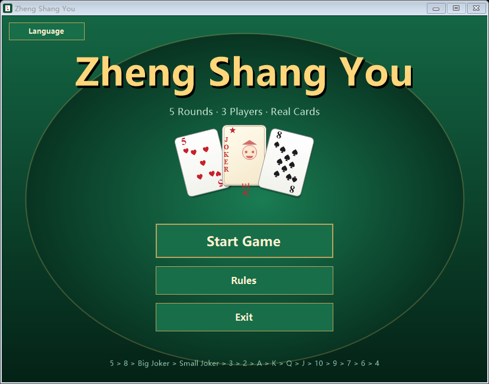

| | |
| --- | --- |
| **Players** | 3 (you vs. two computers) |
| **Rounds** | 5, with 1st / 2nd / 3rd recorded for every round |
| **Deck** | one real 54-card deck (you draw with GDI+, not bitmaps) |
| **Languages** | 简体中文 · 繁體中文 · English · Français · Русский · 日本語 · Español · العربية (full RTL) |
| **Size** | ~130 KB single exe, no installer required |
| **Runtime** | .NET Framework 4.x (already present on Windows 7–11) |

---

## Download

| Build | File | Notes |
| --- | --- | --- |
| Direct exe | [`ZhengShangYou.exe`](https://github.com/SiriusBlackJackson/Competitive-Poker-Game/releases/latest/download/ZhengShangYou.exe) | the game itself, ~130 KB — just double-click |
| Portable | [`ZhengShangYou-Portable.zip`](https://github.com/SiriusBlackJackson/Competitive-Poker-Game/releases/latest/download/ZhengShangYou-Portable.zip) | unzip anywhere and run `ZhengShangYou.exe`; settings stay beside the exe |
| Installer | [`ZhengShangYou-Setup.exe`](https://github.com/SiriusBlackJackson/Competitive-Poker-Game/releases/latest/download/ZhengShangYou-Setup.exe) | its own 8-language UI (switches instantly from a drop-down); installs to `%LOCALAPPDATA%\Programs\ZhengShangYou`, creates Desktop + Start Menu shortcuts, adds an entry to *Apps & features*, launches the game in the chosen language, and can uninstall itself (`--uninstall`) |
| Android | [`ZhengShangYou.apk`](https://github.com/SiriusBlackJackson/Competitive-Poker-Game/releases/latest/download/ZhengShangYou.apk) | minSdk 21, targetSdk 33, signed; same engine, same 8 languages, landscape touch table |

All four builds are attached to [Releases](https://github.com/SiriusBlackJackson/Competitive-Poker-Game/releases).
The `releases/latest/download/…` links always point at the newest release, so they keep working
when a new version is published. Release files use English names only.

## Screenshots

Game table, one screenshot per language (left to right / top to bottom: 简体中文, 繁體中文, English, Français, Русский, 日本語, Español, العربية):

| | |
| --- | --- |
| 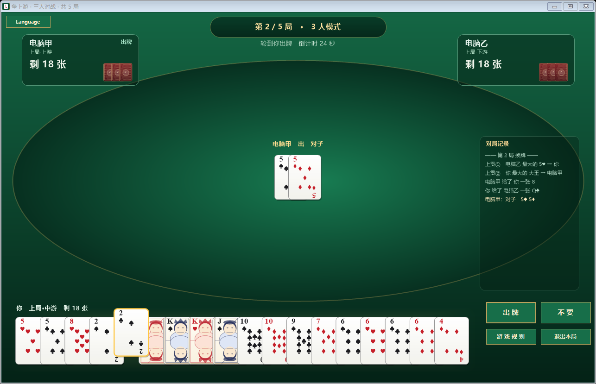 | 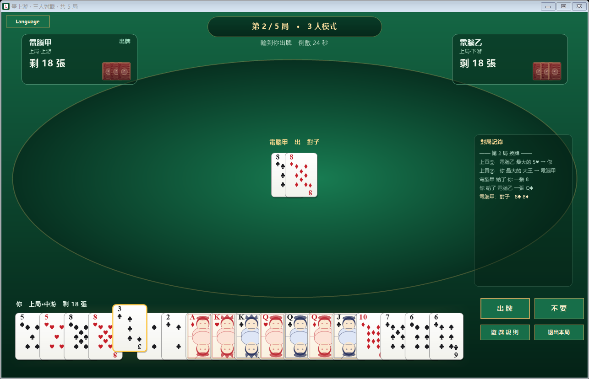 |
| 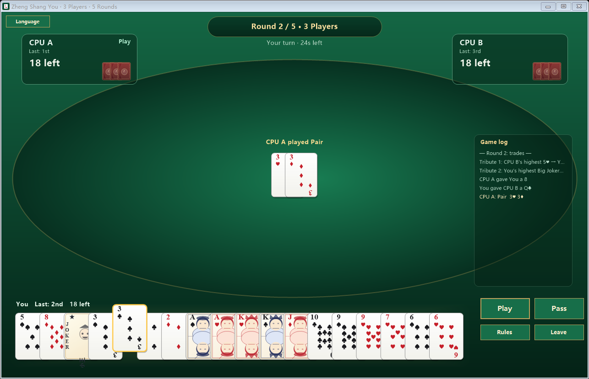 |  |
| 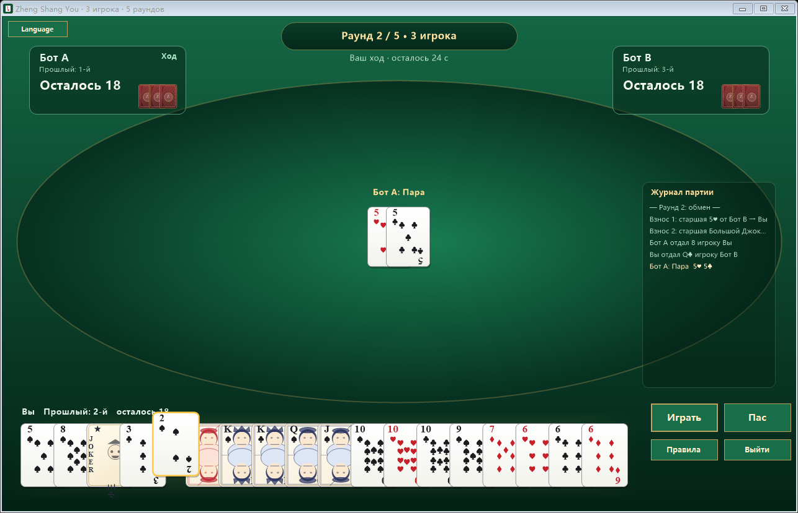 | 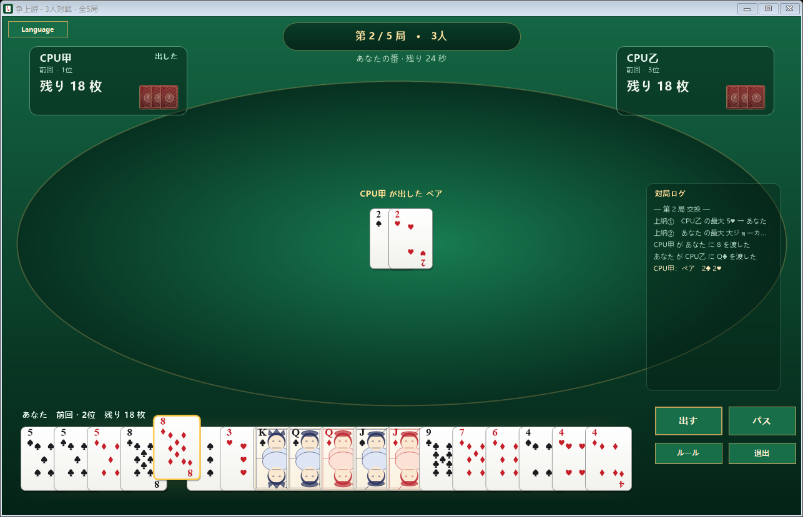 |
| 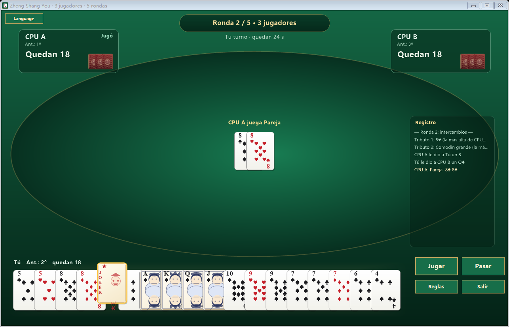 | 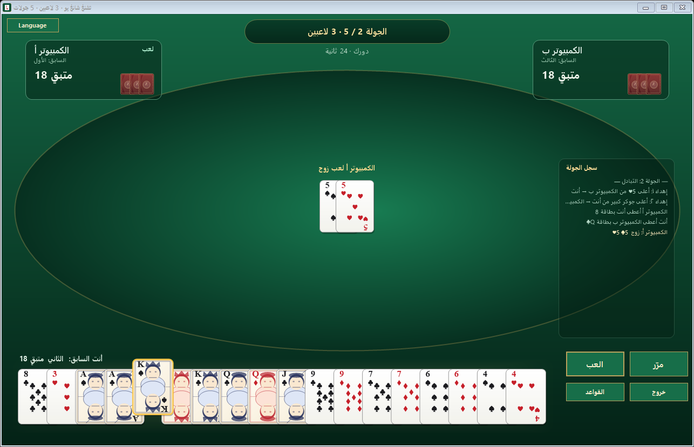 |

Arabic switches the entire interface to right-to-left, including the rules text:

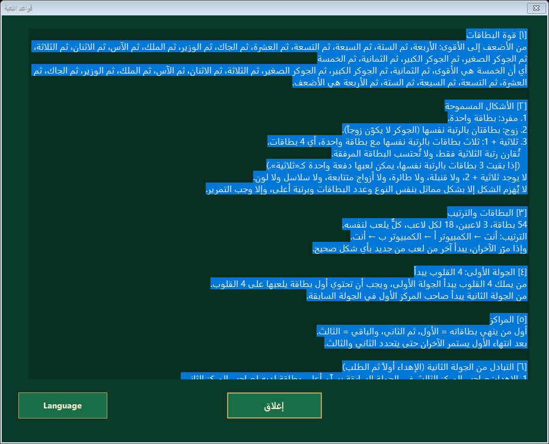

The setup program has its own language drop-down and mirrors instantly — including Arabic RTL:

| | |
| --- | --- |
| 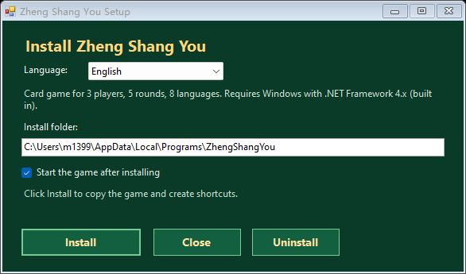 | 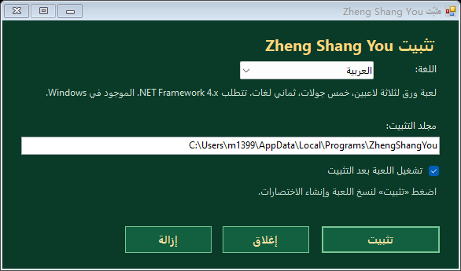 |

## Features

* **Real card faces** — every card is drawn at runtime (rank, suit pips, joker art), so the game
  is crisp at any DPI and the whole thing stays under 150 KB.
* **The full rule set of the region** — a 15-step strength ladder
  `5 > 8 > Big Joker > Small Joker > 3 > 2 > A > K > Q > J > 10 > 9 > 7 > 6 > 4`,
  singles / pairs / triple+1 only, no bombs, no airplanes, no straights, no consecutive pairs,
  and "a lone triple may be played as a triple" when only three cards of one rank remain.
* **Round 1 is decided by the 4 of Hearts** — whoever holds it leads, and the first play must
  contain it.
* **Trades in two separate steps** — first the mandatory tribute (3rd → 2nd, 2nd → 1st, always
  the highest card *as counted before receiving*), then the optional request, which can be
  refused at most three times, may not ask for the giver's current highest card and may not
  ask back the card just tributed.
* **Everything played goes to the centre of the table** — the last play, its type and who made
  it stay visible; when all three pass, the table says who leads next.
* **30-second turn clock** — you may press *Play* / *Pass*, and a timeout passes automatically
  (or plays your smallest legal lead when you are the one leading).
* **8 languages, changeable at any moment** — on the title screen, on the rules screen, and
  mid-game; interface, rules text, log lines, dialogs and results all switch together.
  Long translations auto-fit instead of being clipped, Arabic flips to RTL and uses Segoe UI.
  The installer has the same 8-language switch, and the Android build carries a language pill
  in the table header plus a Language entry in the menu; dialogs mirror in Arabic there too.
* **Portable by default** — put `portable.txt` next to the exe and language settings are written
  to `settings.ini` in the same folder; otherwise `%APPDATA%\ZhengShangYou\settings.ini`.

## Rules in one minute

Full text: [RULES.md](RULES.md) (also inside the game, translated into all 8 languages).

1. 54 cards, 18 each, free-for-all. Order: you → CPU A → CPU B.
2. Allowed: single, pair (same rank, jokers never pair), triple + 1 (4 cards).
   Compare type and card count first, then rank.
3. First out = 1st, second out = 2nd, last = 3rd. All 5 rounds are played.
4. Round 1: the 4 of Hearts leads and must be in the first play. Later rounds: the previous
   winner leads.
5. From round 2: tribute (mandatory, highest card), then request (optional, up to 3 refusals).

## Languages

| Code | Language | Notes |
| --- | --- | --- |
| `zh-CN` | 简体中文 | default |
| `zh-TW` | 繁體中文 | full traditional translation |
| `en` | English | |
| `fr` | Français | |
| `ru` | Русский | |
| `ja` | 日本語 | |
| `es` | Español | |
| `ar` | العربية | right-to-left layout, Segoe UI |

Switch from the **Language** button on any screen, or force one from the command line:

```bat
ZhengShangYou.exe -lang=ru
```

Command-line switches:

| Switch | Effect |
| --- | --- |
| `-lang=xx` | set and remember the language (see codes above) |
| `-selftest` | play 5 rounds headless, write `selftest.txt` (asserts the 4♥ rule and 54-card totals) |
| `-snapshot` | render `start.png`, `game.png`, `dialog.png`, `rank.png`, `rules.png`, `lang.png` |
| `-preview` | render a card sheet png |

## Build from source

No SDK, no NuGet, no third-party library — only `csc.exe` from the .NET Framework. The scripts
were written for the nested layout used during development, so before building from this
single-folder repository, put the files back where the scripts expect them:

| File here | Goes to |
| --- | --- |
| `Core.cs` `Lang.cs` `Cards2D.cs` `UI.cs` `Game.cs` | `src\` |
| `installer-Installer.cs` | `build\installer\Installer.cs` |
| `build.ps1` `package.ps1` | `build\` |
| `engine-*.java`, `app-*.java` | `android\app\src\main\java\com\zhengshengyou\engine\` and `…\app\` |
| `AndroidManifest.xml`, `strings*.xml`, `ic_launcher-*.png` | `android\app\src\main\` (`res\values…`, `res\mipmap-…`) |
| `game.ico` | `assets\icon\game.ico` |
| `screenshot-*.png` | `assets\screenshots\` (only for the README) |

Then:

```powershell
powershell -ExecutionPolicy Bypass -File build\package.ps1
```

Output in `dist\`: `ZhengShangYou.exe`, `ZhengShangYou-Portable.zip`, `ZhengShangYou-Setup.exe`.
Details: [BUILD.md](BUILD.md).

## Layout

This repository deliberately keeps **every file in one folder**, so the whole project is visible
in a single list. The prefix of each name says where it belongs:

```
Core / Lang / Cards2D / UI / Game.cs      desktop sources (rules, 8-language table, card art, widgets, game loop)
build.ps1 / package.ps1                   desktop build and packaging
installer-Installer.cs                    8-language setup + uninstaller
engine-*.java, app-*.java                 Android engine and touch UI
AndroidManifest.xml, strings*.xml, ic_launcher-*.png   Android manifest, localized app names, launcher icons
build-apk.ps1, generate-lang.ps1          Android build and the Lang.java generator
RULES / BUILD / ANDROID / OVERVIEW / FILES.md         documentation
screenshot-*.png, game.ico                screenshots and the icon
ZhengShangYou.exe / -Portable.zip / -Setup.exe / .apk ready-to-run builds
ci-build.yml                              the CI definition (restore it to .github/workflows/build.yml to run it)
```

## Android

The Android edition reuses the same rules engine and the same 8-language strings, with a
touch-first table. The language pill sits in the top-right corner of the table (top-left
when Arabic RTL is active), the start dialog offers a Language button, and the menu has
the full picker; the launcher name itself is localized (争上游 / 爭上游 / Zheng Shang You).
Build instructions and the current status are in
[ANDROID.md](ANDROID.md).

## Documentation

| Document | Contents |
| --- | --- |
| [OVERVIEW.md](OVERVIEW.md) | repository overview — what the game is, the four builds, language coverage, how it is made, what is verified and what is not |
| [FILES.md](FILES.md) | one entry per file (everything except the sources): purpose, size, when to touch it, what stays out of git |
| [RULES.md](RULES.md) | the full rules, in English |
| [BUILD.md](BUILD.md) | desktop build, self-checks, language plumbing, installer behaviour |
| [ANDROID.md](ANDROID.md) | Gradle-free APK pipeline, language API, verification status |
| [README.zh-CN.md](README.zh-CN.md) | the same overview in Chinese |

## Repository

Every source file, the documentation, the screenshots and the four ready-to-run builds live in
this repository, all in the root folder: `ZhengShangYou.exe`, `ZhengShangYou-Portable.zip`,
`ZhengShangYou-Setup.exe` and `ZhengShangYou.apk`. They can be downloaded directly; rebuilding
them from source only needs the folder layout restored (table above).

To publish your own copy, create an empty repository on GitHub and push:

```bash
git remote add origin https://github.com/<you>/<repo>.git
git push -u origin main
```

## License

[MIT](LICENSE). Card artwork is drawn procedurally; no copyrighted card images are included.
