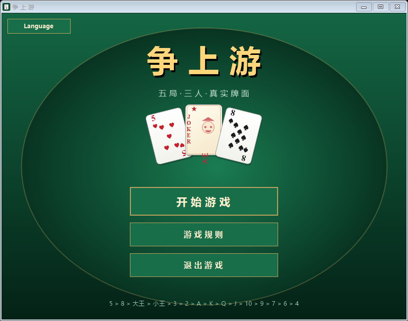
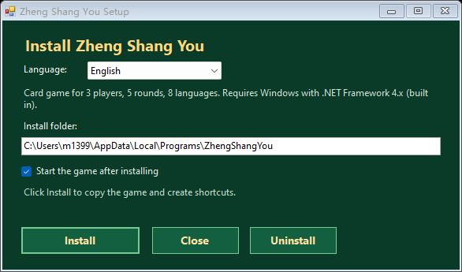
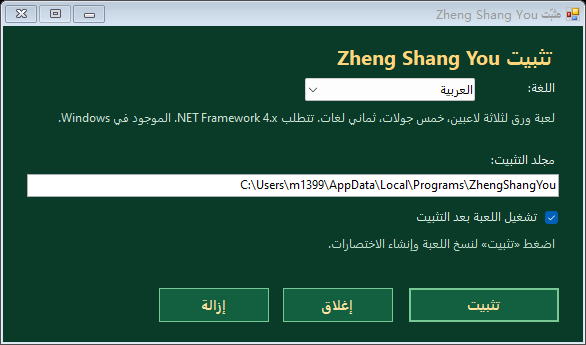

# 争上游 · Zheng Shang You

三人扑克小游戏，5 局定胜负，真实牌面，8 种语言（简体中文 / 繁體中文 / English / Français /
Русский / 日本語 / Español / العربية），纯 C# + GDI+ 手绘，双击即玩，安卓端同规则同语言。



## 下载

| 版本 | 文件 | 说明 |
| --- | --- | --- |
| 桌面版 | `ZhengShangYou.exe` | 130 KB 单文件，Windows 7 以上自带 .NET 4.x 即可运行 |
| 便携版 | `ZhengShangYou-Portable.zip` | 解压即玩，设置在 exe 同目录的 `settings.ini` |
| 安装版 | `ZhengShangYou-Setup.exe` | 安装器本身支持 8 语言，装到 `%LOCALAPPDATA%\Programs\ZhengShangYou`，建桌面与开始菜单快捷方式，可从「应用和功能」卸载 |
| 安卓版 | `ZhengShangYou.apk` | minSdk 21 / targetSdk 33，横屏触屏牌桌，同样 8 语言 |

## 语言切换

- **桌面版**：开始页、规则页、对局中的「语言」按钮都能切；界面、规则正文、对局日志、名次与成绩单一起切换。阿拉伯语整屏 RTL。
- **安装版**：右上角语言下拉框，8 种语言即时刷新，阿拉伯语窗口整体右起；安装完成后按所选语言启动游戏。
- **安卓版**：牌桌右上角语言按钮（阿拉伯语时移到左上）、开始弹窗的「语言」按钮、菜单里的「语言」，三处都能切；阿拉伯语弹窗整体镜像；桌面图标名也做了本地化（争上游／爭上游）。

## 安装器也是 8 语言

安装器右上角有语言下拉框，切换后所有文字、按钮和提示即时刷新；阿拉伯语时整个窗口右起排布。

| | |
| --- | --- |
|  |  |

## 规则要点

牌力：`5 > 8 > 大王 > 小王 > 3 > 2 > A > K > Q > J > 10 > 9 > 7 > 6 > 4`

- 只有单张、对子、三带一（仅剩三张同点时可裸打三张）；没有炸弹、飞机、连对。
- 首局由持红桃 4 的人先出，且第一手必须包含红桃 4。
- 出完牌依次定上游 / 中游 / 下游，5 局全部打完。
- 第 2 局起两步走：先上贡（下游最大牌给中游、中游最大牌给上游，按上贡前手牌算），再要牌（可要一张凑对子或三带一，对方有且愿意才给，最多拒 3 次；不得索要对方当前最大牌，不得索回刚上贡的牌）。
- 每次思考 30 秒，超时自动 pass（领出时出最小合法牌）。
- 出过的牌统一放牌桌中央，三家都不要时提示由谁重新领出。

完整规则：`RULES.md`（游戏内 8 语言版）。

## 文档

| 文档 | 内容 |
| --- | --- |
| [`OVERVIEW.md`](OVERVIEW.md) | 仓库总介绍：游戏是什么、四个版本、语言覆盖、技术思路、已验证与未验证 |
| [`FILES.md`](FILES.md) | 逐个文件说明（源码除外）：用途、大小、什么时候要改、哪些不入库 |
| [`RULES.md`](RULES.md) | 完整规则（英文） |
| [`BUILD.md`](BUILD.md) | 桌面端构建、自检、语言机制、安装器行为 |
| [`ANDROID.md`](ANDROID.md) | 无 Gradle 的 APK 构建流程、语言 API、验证状态 |

## 从源码构建

```powershell
powershell -ExecutionPolicy Bypass -File build\package.ps1            # exe + 便携 zip + setup
powershell -ExecutionPolicy Bypass -File android\build\build-apk.ps1  # APK
```

桌面端只用 Windows 自带的 `csc.exe`；安卓端只用 JDK 17 + Android SDK 命令行工具（javac → d8 → aapt2 → zipalign → apksigner），不依赖 Gradle。细节见 `BUILD.md` 与 `ANDROID.md`。

## 上传到 GitHub

```bash
git remote add origin https://github.com/<你的用户名>/<仓库名>.git
git push -u origin main
```

仓库里已经包含源码、文档、截图和四个可直接运行的产物（`dist/`），克隆下来就能玩。

## 许可

MIT，见 `LICENSE`。牌面全部程序绘制，未使用任何受版权保护的牌图。
